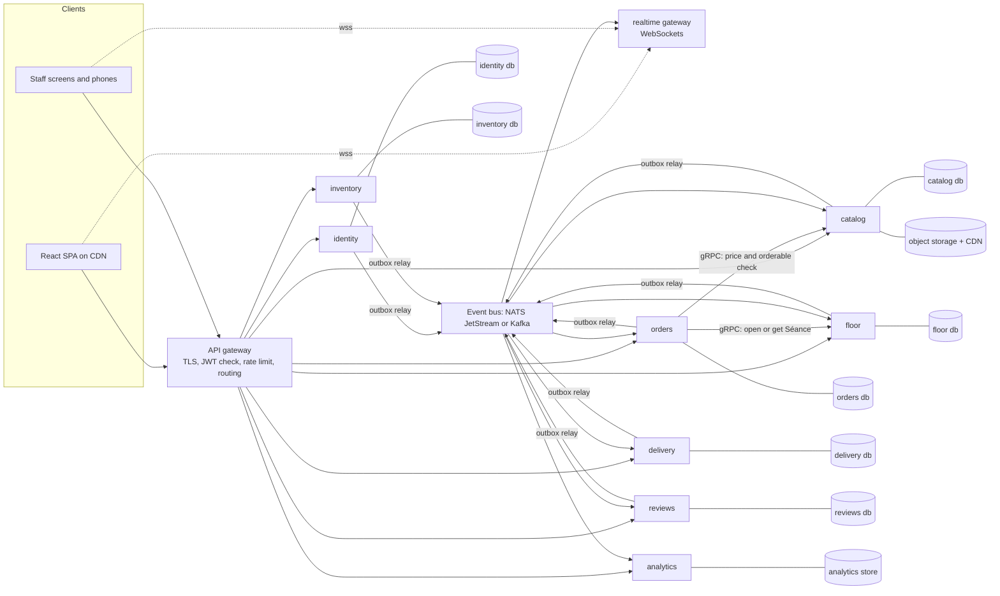
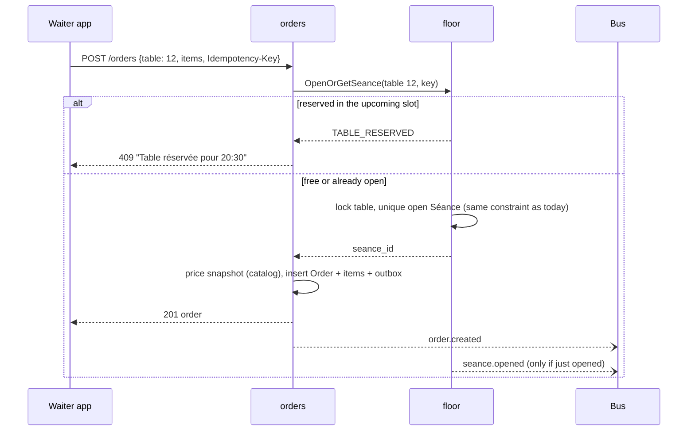
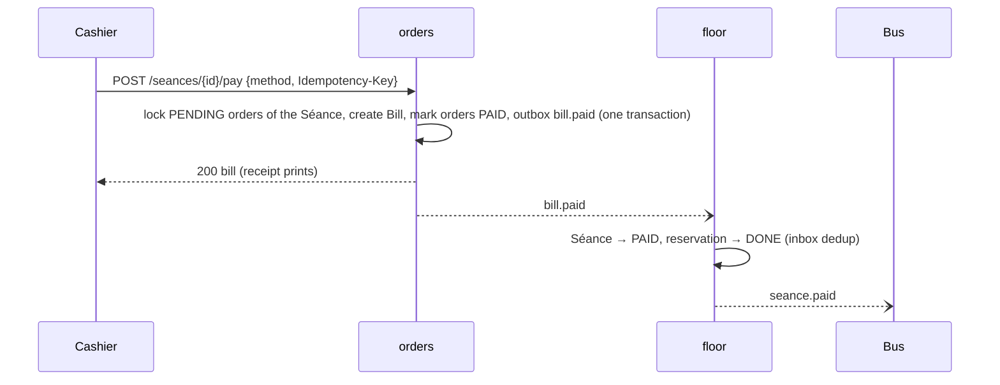
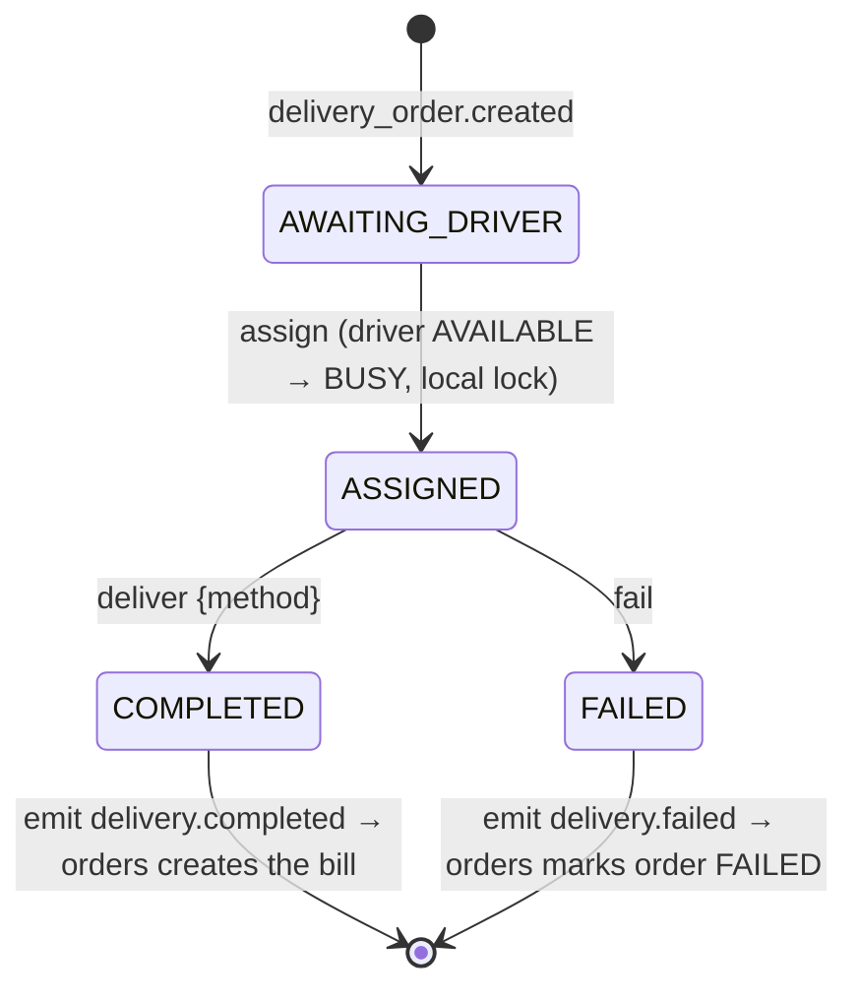

# FEATURE: From monolith to microservices

**Status:** proposal (not implemented) · **Scope:** backend architecture, data, messaging, infrastructure, migration · **Applies to:** RESTO as of October 2026 (17 tickets done, live on Vercel + Render + Supabase)

This document describes how RESTO would move from its current Django monolith to a microservice architecture that scales and is production ready. It covers the following:
- service boundaries derived from the real coupling in the code;
- data ownership;
- the sagas that replace today's single-database transactions;
- events, security, infrastructure, observability, delivery pipeline and costs;
- a step-by-step migration that keeps the app live the whole time.

Domain terms follow `CONTEXT.md`: Séance, Addition, Carte, Plat du jour, Rupture, Recette.

---

## Contents

1. [Should RESTO do this? (decision first)](#1-should-resto-do-this-decision-first)
2. [Today's architecture and its real seams](#2-todays-architecture-and-its-real-seams)
3. [Target architecture](#3-target-architecture)
4. [Service catalogue](#4-service-catalogue)
5. [Data ownership](#5-data-ownership)
6. [Communication: sync calls and events](#6-communication-sync-calls-and-events)
7. [Sagas: the cross-service transactions](#7-sagas-the-cross-service-transactions)
8. [Real-time at scale](#8-real-time-at-scale)
9. [Multi-tenancy](#9-multi-tenancy)
10. [Security](#10-security)
11. [Infrastructure and deployment](#11-infrastructure-and-deployment)
12. [Observability and SLOs](#12-observability-and-slos)
13. [Resilience and failure modes](#13-resilience-and-failure-modes)
14. [Testing and CI/CD](#14-testing-and-cicd)
15. [Migration plan (strangler fig)](#15-migration-plan-strangler-fig)
16. [Capacity and cost estimates](#16-capacity-and-cost-estimates)
17. [Risks and open questions](#17-risks-and-open-questions)
18. [Definition of done](#18-definition-of-done)

---

## 1. Should RESTO do this? (decision first)

**For one restaurant, no.** The current monolith already gives one restaurant everything it needs:
- One Postgres database, so `pay`, `check_in` and `deliver` are single ACID transactions with row locks (`_lock()` in `service/views.py`).
- A real-time layer (Channels + Redis) that pushes events to every screen.
- Roughly 2,500 lines of Python that one person can hold in their head.

Splitting it would turn every one of those transactions into a distributed saga and add a message broker, a gateway and about eight deployables. It would not make a single restaurant any faster.

**Microservices make sense when RESTO becomes a multi-restaurant SaaS.** That means hundreds or thousands of restaurants, several teams, and parts of the system with very different load profiles. The dinner rush hammers WebSockets and ordering, analytics is read-heavy, and inventory is quiet. This document designs for that target.

**Recommended path:**

1. **Now:** keep the monolith. Make it a *modular monolith* with enforced boundaries, a transactional outbox, UUIDs and a `restaurant_id` on every row (Phase 0 in section 15). This work pays off even if no service is ever extracted.
2. **When a trigger in the table below fires:** extract services one by one, starting with the ones that scale differently (real-time gateway, analytics), and leave the tightly coupled core (Floor, Orders) for last.

| Trigger that justifies extraction | Service it points to |
| :-- | :-- |
| More than about 5,000 concurrent WebSockets, or deploys dropping live screens | Realtime gateway |
| Dashboard queries slowing down order writes | Analytics |
| A third-party delivery fleet or courier API integration | Delivery |
| Supplier integrations or EDI with multiple wholesalers | Inventory |
| Several teams stepping on each other in one codebase | Split along team ownership |
| An external SSO or identity provider requirement (e.g. restaurant chains) | Identity |

---

## 2. Today's architecture and its real seams

```
Vercel (React SPA) ──/api, /admin, /media──▶ Render: Daphne (Django + DRF + Channels)
        └──────────── wss:// (JWT in query) ───────▶        │                │
                                                      Supabase Postgres   Redis (channel layer)
                                                      Supabase Storage (photos, S3)
```

Three Django apps share one database:

| App | Models | Notes |
| :-- | :-- | :-- |
| `accounts` | `User` (9 roles, deliverer `availability`), `JobApplication` | JWT auth, refresh cookie, WebSocket JWT middleware |
| `catalog` | `Supplier`, `RestaurantTable`, `Ingredient`, `Dish` (+ Recette M2M), `DailySpecial`, `StockRequest` | `Dish.objects.orderable()` joins ingredients to hide ruptured dishes |
| `service` | `Reservation`, `Seance`, `Order`, `OrderItem`, `Addition`, `Review` | All state transitions, dashboard, WebSocket consumer |

### Couplings that must be redesigned

The following relationships stay invisible while everything shares one database. They are exactly what a split breaks:

| Coupling in the code | Why it matters |
| :-- | :-- |
| `SeanceViewSet.pay`: one transaction locks the Séance and its `PENDING` orders, creates the `Addition`, marks the orders `PAID`, closes the Séance and sets the reservation `DONE` | Spans Floor (Séance, Reservation) and Orders (Order, Addition) |
| `ReservationViewSet.check_in`: locks the zone's tables, creates the Séance and moves the reservation to `CHECKED_IN` | Same aggregate if Séances and Reservations live together |
| `OrderSerializer._seance`: a waiter's first order on a free table opens a walk-in Séance, refused while `Reservation.blocking_walk_ins(now)` holds the table | Ordering needs a Floor decision synchronously |
| `OrderSerializer` checks `Dish.objects.orderable()`, which excludes dishes with a ruptured ingredient | Ordering depends on Catalog and Inventory state |
| `OrderItem.dish` / `daily_special` are `PROTECT` foreign keys | Catalog can't delete a dish that was ever ordered; across services this has to become a snapshot |
| `OrderViewSet.assign_deliverer` locks the `User` row and flips `availability` to `BUSY` in the order's transaction | Delivery state lives on the identity table |
| `OrderViewSet.deliver` creates the delivery's `Addition` and frees the deliverer in one transaction | Spans Delivery and Orders/Billing |
| `Review` validates against an `Addition` (owner, ≤ 7 days, target belongs to it), with a `NULLS NOT DISTINCT` uniqueness constraint | Reviews needs a copy of billing data |
| `DashboardView`: one query layer aggregates `Addition`, `Order`, `OrderItem`, `Review`, `Reservation`, `Ingredient`, `StockRequest` | A natural read model fed by events |
| `broadcast()` runs on `transaction.on_commit` | An event is lost if the process dies between the commit and the publish. Fine for UI refreshes, not for integration between services |

---

## 3. Target architecture



**Principles:**

- **Database per service.** No service reads another service's tables. Cross-service data comes from an API call (only when it must be fresh) or from a local projection built from events (everything else).
- **Events are the integration contract.** Every state change that matters outside a service is published through a transactional outbox. Consumers are idempotent.
- **Synchronous calls only on the critical write path, and only where a decision can't be eventually consistent.** There are exactly two:
  1. Orders asks Floor to open or get a Séance.
  2. Orders asks Catalog for prices and whether a dish can be ordered.
- **The frontend barely changes.** API paths live in one file (`client/src/api.ts`), and the gateway keeps the same `/api/...` routes. Only the WebSocket URL points at the realtime gateway.
- **Keep the stack the team knows.** Domain services stay Python (Django + DRF; FastAPI for the thinnest ones). New technology is limited to the gateway, broker, orchestrator and telemetry.

---

## 4. Service catalogue

| Service | Owns (aggregates) | Public API (via gateway) | Publishes | Consumes |
| :-- | :-- | :-- | :-- | :-- |
| **identity** | User, Role, JobApplication, refresh tokens | `/api/auth/*`, `/api/users`, `/api/job-applications` | `user.created`, `user.updated`, `user.deactivated`, `job_application.accepted` | none |
| **catalog** | Dish, Recette (dish → ingredient ids), DailySpecial, photos | `/api/menu`, `/api/dishes`, `/api/daily-specials` | `dish.created/updated/archived`, `daily_special.published`, `menu.availability_changed` | `ingredient.rupture_started/ended` |
| **inventory** | Ingredient, StockRequest, Supplier | `/api/ingredients`, `/api/stock-requests`, `/api/suppliers` | `ingredient.rupture_started/ended`, `ingredient.created`, `stock_request.created/approved/fulfilled` | none |
| **floor** | RestaurantTable, Reservation (with parking), Séance | `/api/tables`, `/api/reservations` (+ `check_in`, `confirm_parking`…), `/api/seances` (read, `close`) | `reservation.*`, `parking.requested/confirmed`, `seance.opened/closed/paid` | `bill.paid` |
| **orders** | Order, OrderItem (price snapshot), Addition (the bill) | `/api/orders`, `/api/seances/{id}/pay` (routed here), `/api/additions` (+ `ticket`) | `order.created/cancelled`, `bill.paid`, `delivery_order.created` | `seance.closed`, `delivery.assigned/completed/failed`, `dish.*` |
| **delivery** | Driver availability, DeliveryAssignment | `/api/auth/me/availability` (routed here), `/api/deliveries` | `driver.availability_changed`, `delivery.assigned/completed/failed` | `delivery_order.created`, `user.created` (drivers) |
| **reviews** | Review, ReviewableBill (projection) | `/api/reviews` | `review.created` | `bill.paid`, `user.updated` |
| **analytics** | Dashboard read models | `/api/dashboard` | none | everything |
| **realtime** | WebSocket sessions and subscriptions (no business data) | `wss://rt.../ws` | none | everything that maps to a screen |

Three platform components sit around them:
- **API gateway:** Envoy Gateway, Kong or Traefik.
- **Event bus:** NATS JetStream to start, Kafka (Redpanda) at a large scale.
- **Object storage + CDN:** Supabase Storage or S3 + CloudFront.

### Why these boundaries

- **Floor keeps Reservations and Séances together.** The rules "one open Séance per table" and "a reservation within ±2 h blocks walk-ins" are about the same thing: who occupies a table, when. Today they are enforced with a partial unique index and row locks, and they stay that way inside one database. Splitting them would replace a DB constraint with a distributed lock.
- **Orders keeps Order and Addition together.** `pay` sums the `PENDING` orders and marks them `PAID`. Keeping it atomic avoids the worst saga in the system: double billing or lost orders. Payments get their own service only when a real payment provider arrives (section 17).
- **Delivery takes `availability` out of `User`.** Driver availability changes many times a night and is purely delivery state. Identity keeps who the person is and their role; Delivery keeps whether they're free.
- **Catalog and Inventory are separate** because they change for different reasons: the chef and manager edit the Carte, while the stock keeper counts stock. Catalog learns about ruptures through events and keeps a local `unavailable_ingredient_ids` projection, so the Menu stays fast and works even if Inventory is down.

---

## 5. Data ownership

### Rules

1. **Identifiers become UUIDv7.** They are globally unique, time-sortable (good B-tree locality), and safe to generate before an insert, which the outbox needs. Existing integer ids are kept as `legacy_id` during migration.
2. **No foreign keys across services.** A reference is a plain UUID column plus, where the UI needs it, a denormalized snapshot:
   - `OrderItem` stores `dish_id`, `name`, `unit_price`, `kind` (`DISH` / `DAILY_SPECIAL`). This replaces today's two `PROTECT` FKs and their XOR check. The check stays, rewritten on `kind`.
   - `Order` stores `server_id`, `server_name`, `client_id`, `client_name`.
   - `Review` stores `bill_id`, plus `dish_id` or `staff_id` as plain UUIDs. The `NULLS NOT DISTINCT` uniqueness constraint stays local.
3. **Each service owns its migrations.** A DB user can only reach its own schema or database.
4. **Projections are disposable.** Every projection table can be rebuilt by replaying the event stream, which also rebuilds Analytics.

### Projections each service keeps

| Service | Projection | Built from | Used for |
| :-- | :-- | :-- | :-- |
| catalog | `unavailable_ingredient` (ingredient_id) | `ingredient.rupture_started/ended` | `orderable()`: a dish is orderable if `is_available` and none of its Recette ids is unavailable |
| orders | `staff_directory` (user_id, name, role) | `user.*` | names on orders and receipts |
| reviews | `reviewable_bill` (bill_id, client_id, paid_at, dish_ids, daily_special_ids, staff_ids) | `bill.paid` | the 7-day and "target belongs to the bill" checks, with no call to Orders |
| delivery | `driver` (user_id, name, active) | `user.created/updated/deactivated` with role `DELIVERER` | who can be assigned |
| analytics | revenue by day, best sellers, ratings by staff and dish, no-shows, failed deliveries, ruptures, pending stock requests | all events | `/api/dashboard` in one indexed read |

### Storage choices

| Store | Technology | Why |
| :-- | :-- | :-- |
| Service databases | PostgreSQL 17, one logical database per service on a managed cluster at first, separate instances later for heavy services (orders, floor) | Constraints and row locks keep today's invariants inside each service |
| Connection pooling | PgBouncer in transaction mode (or Supabase / RDS Proxy) | Many pods × many services would otherwise exhaust connections |
| Analytics | Postgres with materialized rollups up to about 1,000 restaurants, then ClickHouse | The dashboard is aggregations over append-only facts |
| Cache | Redis (menu per restaurant, gateway rate limits) | The Menu is read on every landing visit and changes rarely; it is invalidated by `menu.availability_changed` |
| Files | Object storage + CDN, presigned uploads | The API never proxies image bytes. Catalog issues a presigned PUT URL, and the browser uploads directly |

---

## 6. Communication: sync calls and events

### Synchronous (internal gRPC, with REST/JSON at the gateway)

Only two calls sit on the write path:

| Caller → callee | Call | Why it can't be async | Guarding |
| :-- | :-- | :-- | :-- |
| orders → floor | `OpenOrGetSeance(restaurant_id, table_number, name, idempotency_key)` → `{seance_id}` or `TABLE_RESERVED` | A waiter needs an immediate yes or no; Floor owns the walk-in rule | 300 ms timeout, 2 retries with jitter (the call is idempotent), circuit breaker. When open: "Table service is unavailable, retry", never a guess |
| orders → catalog | `PriceAndCheck(restaurant_id, items[])` → prices and orderable flags | The price snapshot and the "Plat disponible" check must be current | 200 ms timeout. Fallback: Orders' last-known price cache, which is acceptable for at most 60 s and logged |

Every other cross-service need is an event.

**Gateway-level rules:**
- Every mutating request carries an `Idempotency-Key` header. It is mandatory on `pay`, `deliver` and order creation, so a retried tap on a phone never double-bills.
- The gateway verifies the JWT and forwards `X-User-Id`, `X-Role` and `X-Restaurant-Id`. Services verify the JWT again (zero trust) but don't call Identity.

### Asynchronous: the event bus

**Broker choice:**

| Option | Use it when | Notes |
| :-- | :-- | :-- |
| **NATS JetStream** (recommended start) | Up to about 10k events/s; small ops team | One small binary, persistent streams, per-subject ordering, consumer acks, simple to run on Kubernetes |
| **Kafka / Redpanda** | Large SaaS, event replay for analytics at volume, CDC with Debezium | Partition key `restaurant_id` gives per-restaurant ordering; heavier to operate (use a managed service) |
| RabbitMQ | Mostly commands and work queues | Weaker for replay and event sourcing projections |

**Envelope** (CloudEvents 1.0, JSON):

```json
{
  "specversion": "1.0",
  "id": "0192f4c6-6b1e-7c3a-9a51-3f1f0d2e8b77",
  "source": "orders",
  "type": "resto.bill.paid.v1",
  "time": "2026-10-28T20:41:07Z",
  "subject": "bill/0192f4c6-...",
  "restaurantid": "0191aa00-...",
  "traceparent": "00-4bf92f3577b34da6a3ce929d0e0e4736-00f067aa0ba902b7-01",
  "data": {
    "bill_id": "0192f4c6-...",
    "seance_id": "0192f4b0-...",
    "client_id": "0191ab12-...",
    "collected_by": "0191ab09-...",
    "amount": "5200.00",
    "method": "CARD",
    "lines": [{ "kind": "DISH", "item_id": "...", "name": "Couscous royal", "quantity": 2, "unit_price": "1800.00" }],
    "staff_ids": ["0191ab05-..."]
  }
}
```

Event conventions:
- Money is a string. This is already a project rule, because payloads must be msgpack-able.
- Types are versioned (`.v1`). Adding a field is a backward-compatible change; removing or renaming one means a new version, published in parallel until every consumer has moved.
- Schemas live in the repo (`contracts/events/*.json`, JSON Schema). CI fails on an incompatible change.

**Event catalogue** (what replaces today's `broadcast()` calls, plus the integration events the split needs):

| Event | Producer | Consumers | Today's equivalent |
| :-- | :-- | :-- | :-- |
| `reservation.created` / `confirmed` / `checked_in` / `cancelled` / `no_show` | floor | realtime, analytics | `reservation_created`… on `reservations` |
| `parking.requested` / `confirmed` / `refused` | floor | realtime (parking + client) | `parking_requested` on `parking` |
| `seance.opened` / `closed` / `paid` | floor | orders, realtime, analytics | `seance_opened/closed` on `kitchen_pos` |
| `order.created` / `cancelled` | orders | realtime, analytics | `order_created/cancelled` |
| `delivery_order.created` | orders | delivery, realtime | `order_created` on `deliveries` |
| `bill.paid` | orders | floor, reviews, analytics, realtime | `addition_paid` on `manager` |
| `delivery.assigned` / `completed` / `failed` | delivery | orders, realtime, analytics | `delivery_assigned`, `order_delivered`, `delivery_failed` |
| `driver.availability_changed` | delivery | realtime | `driver_availability` |
| `ingredient.rupture_started` / `ended` | inventory | catalog, realtime, analytics | `rupture_started` on `manager` |
| `stock_request.created` / `approved` / `fulfilled` | inventory | realtime, analytics | `stock_request_created`, `stock_request_updated` |
| `menu.availability_changed` | catalog | realtime, gateway cache | (new: the Menu refreshes live) |
| `review.created` | reviews | analytics, realtime | `review_created` |
| `user.created` / `updated` / `deactivated` | identity | orders, delivery, reviews | (new) |

### Transactional outbox (replaces `transaction.on_commit` broadcasting)

```
BEGIN;
  UPDATE orders ... ;                              -- the state change
  INSERT INTO outbox (id, type, payload, ...);     -- the event, same transaction
COMMIT;

relay (separate process): SELECT ... FROM outbox WHERE published_at IS NULL
                          ORDER BY id LIMIT 500 FOR UPDATE SKIP LOCKED
                          → publish to the bus → mark published_at
```

How the outbox works:
- **No lost events.** An event exists exactly when its state change committed. Delivery is at least once.
- **Relay:** a small poller per service, or Debezium reading the WAL when the bus is Kafka. Published rows are pruned after 7 days.
- **Consumer side, an inbox table** `(event_id PRIMARY KEY, processed_at)`. A handler inserts the event id in the same transaction as its effect, so a redelivered event is a no-op. Together with the outbox, that gives **effectively-once** processing.
- **Ordering:** per-restaurant subjects or partitions (`resto.<restaurant_id>.orders.*`) keep one restaurant's events in order. Handlers also compare a `version` column, so a late, older event can't overwrite newer state.

---

## 7. Sagas: the cross-service transactions

Each saga below replaces one `transaction.atomic` that spans services today. They are **choreographed** (services react to events). Only the delivery lifecycle has enough steps to deserve an explicit state machine, which lives in the Delivery service.

### 7.1 Check-in (stays local)

`check_in` locks tables, creates the Séance and updates the Reservation, all inside **floor**. That is still one ACID transaction, and it publishes `reservation.checked_in` and `seance.opened` through the outbox.

### 7.2 Walk-in: the first order on a free table



Failure modes:
- **Floor is down:** the order is refused with a clear message. No Séance is ever guessed.
- **Floor opened the Séance but Orders failed to insert the order:** the Séance is open and empty, exactly like a table seated by the desk. A janitor job in Floor closes empty Séances older than 30 minutes. The idempotency key makes the waiter's retry reuse the same Séance.

### 7.3 Pay the Addition



- **The money part stays atomic** inside orders, so double billing is impossible: the orders are row-locked and the idempotency key is unique.
- **Floor follows within milliseconds.** In the gap, Orders refuses new orders on a Séance it has already billed: it records `billed_seance_ids` locally, and `seance.closed` / `seance.paid` events keep that set accurate.
- **No compensation is needed.** The only thing that can go wrong after the commit is Floor being down, and then the event waits in the bus until it comes back.

### 7.4 Delivery lifecycle (orchestrated in delivery)



- Driver availability and the assignment live in the **same** service. "Only an AVAILABLE driver can be assigned, and becomes BUSY" stays a local row-locked transaction, as `assign_deliverer` does today.
- `delivery.completed` carries `order_id`, `amount`, `method` and `collected_by`. **orders** creates the delivery's bill idempotently, with the unique key `(source='delivery', delivery_id)`. If Orders is down, the courier's app still shows "Livrée et encaissée": the money was collected in person, and the bill appears as soon as Orders consumes the event.

### 7.5 Rupture → the Menu

`PATCH /ingredients/{id} {is_out_of_stock: true}` in **inventory** emits `ingredient.rupture_started`. **catalog** adds the id to its `unavailable_ingredient` projection, recomputes affected dishes, invalidates the Menu cache and emits `menu.availability_changed`. The realtime gateway refreshes open Menu pages.

**Window:** about 1 s, during which a client could still order a dish that just became unavailable. That's acceptable, because the restaurant already handles "plus de tomates" verbally. If not, Orders' `PriceAndCheck` call to Catalog closes most of the window.

### 7.6 Job application accepted → staff account

**identity** accepts the application and creates the `User` from the already-hashed password, both locally as today. It then emits `user.created` with role `DELIVERER` or `PARKING_ATTENDANT`. **delivery** adds the driver to its projection.

### 7.7 Stock request approval

This one is local to **inventory**: `approve` picks a supplier and `fulfill` updates stock, both in the same database. The requester's notification (`stock_request.approved`) goes through realtime.

---

## 8. Real-time at scale

Today one Daphne process holds every socket, and Channels groups (`kitchen_pos`, `reservations`, `parking`, `deliveries`, `manager`, `user_<id>`) fan out through Redis. That couples socket capacity to API capacity, and every API deploy drops live screens.

**Target: a dedicated realtime gateway.**

- **Stateless pods** holding WebSockets only. They speak no business logic and keep only in-memory subscription maps. The current `GROUPS` role → channel mapping in `service/consumers.py` moves here, prefixed by tenant, e.g. `r:<restaurant_id>:kitchen_pos`.
- **Event flow:**
  1. The gateway consumes domain events from the bus through one durable consumer per pod group.
  2. It maps each event to rooms and pushes to the local sockets.
  3. Cross-pod fan-out happens through the bus itself (every pod subscribes) or through Redis pub/sub.
- **Auth:**
  - **Replaces today's setup:** the access JWT in the query string, which ends up in proxy logs.
  - **New flow:** the client calls `POST /api/realtime/ticket`, which Identity serves through the gateway. It returns a single-use ticket valid for 30 s, and the socket connects with it.
  - **Origin check:** the gateway keeps checking `Origin`, as `AllowedHostsOriginValidator` does today.
- **Delivery semantics:**
  - Events carry a `seq` per room.
  - On reconnect the client sends its last `seq`, and the gateway replays from a short per-room buffer (5 minutes, in Redis Streams).
  - If the gap is too large, the server says "resync" and the client refetches, exactly what `useLiveRefresh` already does after a reconnect. The existing frontend behaviour is the fallback, so nothing breaks.
- **Scaling:** about 10–20k idle sockets per pod (Go, or Python with uvloop). Autoscaling (HPA) on connection count. Deploys drain connections gradually, using `preStop` plus a "reconnect to another pod" close code.
- **Language:** stay with Python (Starlette + websockets) for consistency up to about 50k sockets. Rewrite this one component in Go only if needed. It has no business logic, so a rewrite is cheap.

---

## 9. Multi-tenancy

Scaling only matters if RESTO serves many restaurants, so tenancy is designed in from the start:

- **Every aggregate gets a `restaurant_id`.** The JWT carries `restaurant_id` and `role`; staff belong to one restaurant, clients can follow several.
- **Isolation:**
  - **Default:** a shared database with `restaurant_id` in every unique constraint and index (e.g. `UNIQUE (restaurant_id, number)` for tables; one open Séance per `(restaurant_id, table_id)`).
  - **Defence in depth:** Postgres Row-Level Security policies keyed on `current_setting('app.restaurant_id')`, set per transaction.
  - **Big chains:** a dedicated database ("silo") through the same code, chosen per tenant in a routing table.
- **Per-tenant settings** that are constants today move to a `restaurant_settings` table, owned by floor and read through events or a cache: `RESERVATION_SLOT` (2 h), `TIME_ZONE` (Africa/Algiers), currency (DA).
- **Fairness:** gateway rate limits per tenant. Bus subjects are partitioned per tenant, so one busy restaurant can't starve others.

---

## 10. Security

| Area | Design |
| :-- | :-- |
| User auth | Identity issues **RS256** access JWTs (5 min) and keeps the refresh token in an httpOnly, `SameSite=Strict`, path-scoped cookie with a blacklist on logout, as today. Public keys are published at `/.well-known/jwks.json`; services cache them and verify locally. |
| Authorization | Coarse at the gateway (route → allowed roles), fine in each service. Today's `RoleViewSet` / `read_roles` / `action_roles` pattern stays and moves into a shared library, `resto-auth`. `ADMIN_MANAGER` passes everywhere within its own restaurant. |
| Service-to-service | mTLS from a service mesh (Linkerd: lighter than Istio). Workload identities (SPIFFE) and an allow-list of which service may call which, e.g. only orders → floor `OpenOrGetSeance`. |
| Network | Kubernetes NetworkPolicies: only the gateway is public; databases accept connections only from their own service; the bus only from services. |
| Secrets | A cloud secret manager or Vault, synced by External Secrets Operator. No secret in images, repos or env files; rotation without redeploys. (Today the secrets live in Render's env vars; the S3 keys and DB password were never stored locally.) |
| Data | TLS everywhere, including Postgres (`sslmode=verify-full`). Encryption at rest is managed. Personal data (names, phones, addresses) lives only in identity, orders and delivery; analytics stores ids and aggregates. GDPR or Algerian data-law delete requests go through `user.deactivated`, after which each service anonymizes its projections. |
| Payments | The till records cash and card payments and never stores card data, so RESTO is out of PCI DSS scope. Online payments would go through a PSP (Stripe or a local acquirer) with hosted fields; see section 17. |
| Audit | Money and access actions (`bill.paid`, refunds, role changes, job application accepts) are written to an append-only audit stream, kept for 5 years. |
| Supply chain | Pinned dependencies, Dependabot, image scanning (Trivy) in CI, signed images (cosign), minimal base images (distroless or `python:3.12-slim`), non-root containers. |
| Edge | WAF and DDoS protection at the CDN or load balancer, plus per-IP and per-tenant rate limits at the gateway, stricter on `/auth/token` and `/auth/register`. |

---

## 11. Infrastructure and deployment

### Runtime platform

| Concern | Choice | Notes |
| :-- | :-- | :-- |
| Orchestration | Managed Kubernetes (GKE Autopilot, EKS, or DigitalOcean DOKS for cost) | A PaaS like Render can host the first 3–4 services (Phase 2) before the move to Kubernetes |
| Packaging | One Dockerfile per service (multi-stage), Helm chart per service from a shared library chart | Same `migrate && serve` startup pattern as today's `server/Dockerfile`, but migrations run as a pre-deploy Job, not on every pod start |
| Delivery | GitOps with Argo CD; Argo Rollouts for canary (10 % → 50 % → 100 %, auto-rollback on SLO burn) | Environments: `dev`, `staging`, `prod` |
| Infrastructure as code | Terraform: cluster, managed Postgres, bus, buckets, DNS, secret manager | One state per environment |
| Autoscaling | HPA on CPU and requests/s for APIs; **KEDA** on bus consumer lag for event handlers; realtime on open connections | Minimum 2 replicas per service in prod, spread across zones; PodDisruptionBudgets |
| Health | `/healthz` (liveness: process up) and `/readyz` (readiness: DB and bus reachable), separate from business endpoints | Today Render pings `/api/menu/`, which also hits the database |
| Frontend | Unchanged: static SPA on a CDN (Vercel). The gateway is the only API origin, so the refresh cookie stays first-party | `vercel.json` rewrites point at the gateway instead of the monolith |

### Repository layout (monorepo)

```
resto/
  client/                      # React SPA (unchanged)
  services/
    identity/  catalog/  inventory/  floor/  orders/  delivery/  reviews/  analytics/  realtime/
  libs/
    resto-auth/                # JWT verification, role permissions (from accounts/permissions.py)
    resto-events/              # outbox, inbox, CloudEvents envelope, publisher, consumer base
    resto-testing/             # testcontainers fixtures, contract helpers
  contracts/
    events/*.json              # JSON Schemas, versioned
    grpc/*.proto               # floor.OpenOrGetSeance, catalog.PriceAndCheck
    openapi/                   # one spec per service, merged at the gateway for /api/docs
  deploy/
    helm/  terraform/  argocd/
```

A monorepo keeps one PR able to change a contract and both of its sides. CI builds only what a change touches, using path filters.

---

## 12. Observability and SLOs

| Pillar | Tooling | What to instrument |
| :-- | :-- | :-- |
| Traces | OpenTelemetry SDK in every service → Tempo or Jaeger | `traceparent` propagates over HTTP, gRPC **and** events (it's in the envelope), so one trace shows a waiter's tap → orders → floor → bus → realtime → kitchen screen |
| Metrics | Prometheus + Grafana | RED per endpoint (rate, errors, duration); bus lag per consumer; outbox backlog; open WebSockets; DB pool saturation |
| Logs | JSON to stdout → Loki | Every line carries `trace_id`, `restaurant_id`, `user_id` and the event id. No tokens or PII in logs |
| Business dashboards | Grafana on the analytics store | Orders per minute per restaurant, payment success, delivery failure rate |
| Errors | Sentry | Frontend and backend, release-tagged |

**SLOs** (prod, monthly):

| SLO | Target |
| :-- | :-- |
| API availability (non-5xx), critical routes: order create, pay, check-in, deliver | 99.9 % |
| Order create latency | p95 < 300 ms, p99 < 800 ms |
| Pay latency | p95 < 400 ms |
| Event to screen (commit → WebSocket push) | p95 < 2 s |
| Outbox backlog older than 30 s | 0 events, 99 % of the time |
| Menu read | p95 < 150 ms (cached) |

Alerts are built on error-budget burn rate (fast and slow windows), not raw thresholds.

---

## 13. Resilience and failure modes

| Failure | What users see | Mechanism |
| :-- | :-- | :-- |
| **analytics down** | Dashboard shows "données en cours de mise à jour"; service unaffected | Analytics is off the write path; it catches up from the bus |
| **realtime down** | Screens show "Hors ligne" and fall back to periodic refresh | `useLiveRefresh` already refreshes after reconnects; add a 30 s poll while offline |
| **catalog down** | Menu served from cache; ordering works with cached prices for up to 60 s, then "Carte indisponible" | Price cache + circuit breaker |
| **floor down** | Walk-ins and check-ins refused with a clear message; orders on already-open Séances keep working; pay works | Orders only calls Floor for new Séances |
| **orders down** | No new orders or payments (core outage, highest priority); deliveries can still be marked delivered and billed on recovery | Multi-replica, multi-zone; pay is idempotent so retries are safe |
| **bus down** | Writes still succeed (outbox stores events); screens stop updating; projections lag | Outbox backlog alert; a 3-node cluster for the bus |
| **Poison event** | Nothing for users; one consumer stalls | 5 retries with exponential backoff, then a dead-letter stream with an alert; handlers are idempotent so replay is safe |
| **Database failover** | A few seconds of 503s, then recovery | Managed HA Postgres (synchronous standby), PgBouncer reconnects, client retries with the same idempotency key |

General rules:
- Every outbound call has a timeout.
- Retries happen only on idempotent operations, with exponential backoff and jitter.
- Circuit breakers come from the mesh.
- Bulkheads: separate connection pools for critical routes.
- Graceful shutdown: drain HTTP, finish in-flight events, then exit.

---

## 14. Testing and CI/CD

**Test pyramid per service:**

| Level | What | Tooling |
| :-- | :-- | :-- |
| Unit | Domain rules (walk-in blocking, Recette orderability, review window) | pytest, no I/O |
| Integration | Service + its own Postgres + bus | testcontainers (Postgres 17, NATS); the 30 current tests split by service and become this layer. `APITransactionTestCase` lessons still apply to WebSocket tests in realtime |
| Contract (sync) | orders ↔ floor, orders ↔ catalog | Consumer-driven contracts (Pact) checked in both pipelines |
| Contract (events) | Producer payloads valid against `contracts/events`, consumers tested against example payloads | JSON Schema validation + a compatibility check on every PR |
| End to end | The 9 role journeys (book → park → check-in → order → pay → receipt; delivery; rupture) | Playwright against `staging` (the same flows used to verify each ticket) |
| Resilience | Kill floor during walk-ins, pause the bus during pay, replay a DLQ | Chaos experiments in staging (Litmus), monthly |
| Load | Dinner-rush profile (section 16) | k6, before each major release |

**Pipeline (per service, path-filtered):**

1. Lint, type-check, unit tests.
2. Integration tests with testcontainers.
3. Contract and schema checks.
4. Build the image, scan it (Trivy), sign it (cosign), push.
5. Deploy to staging through GitOps; run the Playwright smoke suite.
6. Canary to prod with automatic rollback on SLO burn.

**Database migrations use expand → migrate → contract**, never a breaking change in one deploy:
1. Add the new column.
2. Write to both old and new.
3. Backfill.
4. Read from the new one.
5. Drop the old one in a later release.

---

## 15. Migration plan (strangler fig)

The app stays live throughout. Each phase is shippable on its own and can stop there.

| Phase | Kind | What | Effort (weeks, 1–2 devs) |
| :-- | :-- | :-- | :-- |
| 0 | Prepare | Modular monolith | 4 |
| 1 | Prepare | Gateway in front | 1 |
| 2 | Edge service | Realtime gateway | 3 |
| 3 | Edge service | Analytics | 3 |
| 4 | Domain service | Identity | 3 |
| 5 | Domain service | Inventory + catalog | 4 |
| 6 | Domain service | Delivery | 3 |
| 7 | Domain service | Floor + orders | 6 |
| 8 | Domain service | Reviews, cleanup | 2 |

Phases 2 to 8 only start once a trigger from section 1 fires.

### Phase 0: modular monolith (do this even if nothing is ever extracted)

1. **Restructure the Django apps along the target boundaries:** identity, catalog, inventory, floor, orders, delivery, reviews, analytics, realtime.
   - Move `RestaurantTable` from `catalog` to `floor`.
   - Move `Supplier`, `Ingredient` and `StockRequest` to `inventory`.
   - Move deliverer `availability` from `User` to a `delivery.Driver` model.
2. **Enforce boundaries in CI** with `import-linter`: a module imports another only through its public `api.py`, and no module reads another's models directly.
3. **Replace cross-module ORM joins with calls to the public functions.** For example, `Dish.objects.orderable()` stops joining `Ingredient` and reads a local `unavailable_ingredient` table, filled by an in-process event.
4. **Add the outbox:** every `broadcast()` becomes `publish(event)`, which writes to `outbox` in the same transaction. A relay sends events to Channels exactly as today, so the UI behaviour doesn't change.
5. **Add `restaurant_id` and UUIDv7 columns** with expand/contract migrations. `seed_demo` creates one restaurant.
6. **Snapshot `OrderItem`** (`name`, `unit_price`, `kind`) and drop the `PROTECT` FKs once the read paths use the snapshot.
7. **Add `Idempotency-Key` support** on pay, deliver and order create.
8. **Add OpenTelemetry and structured logs.**

Exit criteria:
- All 30 tests green.
- `import-linter` passes.
- The live demo is unchanged for users.

### Phase 1: gateway in front

1. Put the gateway in front of the monolith. All routes still go to the monolith.
2. Move JWT verification, rate limiting and request ids to the gateway.
3. Point `vercel.json` rewrites at the gateway.

### Phase 2: extract realtime

1. Deploy the realtime gateway. The monolith's outbox relay publishes to the bus (NATS) instead of Channels.
2. Add the ticket endpoint.
3. Switch `VITE_WS_URL` to the gateway.
4. Remove Channels and Daphne from the monolith; it becomes a plain WSGI app (gunicorn), simpler to scale.

Rollback: switch `VITE_WS_URL` back.

### Phase 3: extract analytics

1. Build the read models from the bus.
2. Backfill by replaying the outbox history, or a one-off export of `Addition`, `Order`, `Review`…
3. Compare `/api/dashboard` responses from both implementations in shadow mode for a week.
4. Flip the gateway route.

### Phase 4 onwards: domain services, one at a time

For each service, follow this recipe:
1. Create the service with its own database. Copy the module code; the boundaries already exist from Phase 0.
2. Backfill its data with CDC (Debezium) or a migration script. Keep it in sync from monolith events until cutover.
3. Shadow reads: the gateway sends a copy of read traffic to the new service and compares responses.
4. Cut over writes with a gateway route flip, during a quiet hour (not dinner service).
5. The monolith now consumes the service's events instead of owning the data. Delete the module's tables a release later.

**Order and reasons:**
- **identity** goes first, because everything needs JWKS.
- **inventory + catalog** next: low write volume, a clean event (rupture).
- **delivery**: a self-contained state machine.
- **floor + orders** last, because they hold the core invariants and the two sync calls.
- **reviews** at the end; it needs only `bill.paid`.

### Data migration specifics

| Data | Approach |
| :-- | :-- |
| Integer ids → UUIDv7 | Added in Phase 0; `legacy_id` kept, and APIs accept both during a transition window |
| `User.availability` | Copied to `delivery.Driver` in Phase 0, then removed from `User` |
| Photos | Already in Supabase Storage (S3), so no move is needed; Catalog switches to presigned uploads |
| Refresh-token blacklist | Moves with identity; existing sessions keep working because cookie name and path are unchanged |
| Redis | Today it's shared with another project on db 1; production gets a dedicated cluster (rate limits, cache, realtime replay buffer) |

---

## 16. Capacity and cost estimates

### Load model (SaaS target: 1,000 restaurants)

| Metric | Assumption | Result |
| :-- | :-- | :-- |
| Orders | 300 per restaurant per day, 60 % between 19:00 and 22:00 | ~300k/day; **~35 orders/s peak** (×2 safety = 70/s) |
| API requests | ~25 per order (reads, refreshes, menu, dashboard) | **~1,750 req/s peak** |
| Events | ~6 per order + reservations, stock, deliveries | **~250 events/s peak** |
| WebSockets | ~15 screens per restaurant during service | **~15,000 concurrent sockets** |
| Data | ~2 KB per order with items, plus events | ~20 GB/year of operational data; events retained 30 days on the bus, forever in analytics |

None of this is big data. The scaling pressure points are **sockets** (realtime gateway), **dinner-rush write bursts** on orders and floor (horizontal pods + PgBouncer + a properly sized Postgres), and **dashboard aggregations** (analytics). That is why those are the first extractions.

### Rough monthly cost

| Setup | Monthly cost (USD, approx.) | Notes |
| :-- | :-- | :-- |
| Today (free tiers: Vercel, Render, Supabase) | $0 | Sleeps when idle; fine for a portfolio demo |
| Production monolith (1 restaurant to ~50) | $60–150 | Always-on API (2 instances), managed Postgres with HA, Redis |
| Microservices, small (Phase 2–3, ~50–200 restaurants) | $400–900 | Small managed Kubernetes, NATS (3 nodes), Postgres HA, observability stack |
| Microservices, full (~1,000 restaurants) | $2,500–6,000 | Multi-zone cluster, separate Postgres instances for orders and floor, managed Kafka or NATS, ClickHouse, Grafana Cloud or self-hosted |

Team: the full architecture realistically needs **3–5 engineers** plus on-call. That's another reason Phase 0 alone is the right move until revenue or team size changes.

---

## 17. Risks and open questions

| Risk | Mitigation |
| :-- | :-- |
| Distributed transactions introduce new inconsistency windows (sections 7.3 and 7.5) | Keep money atomic inside orders; idempotency keys; inbox and outbox; reconciliation job comparing paid Séances in floor and bills in orders, run nightly with an alert on mismatch |
| Operational load (bus, mesh, Kubernetes, nine deployables) | Managed services wherever possible; extract only on triggers; platform libraries (`resto-events`, `resto-auth`) so each service is thin |
| Debugging across services | OpenTelemetry trace propagation through events from day one (Phase 0) |
| Schema drift between producers and consumers | Contracts in the repo, compatibility checks in CI, versioned event types |
| Local development gets heavy | `docker compose` profile per slice (e.g. `orders` + `floor` + `catalog` + bus), and the modular monolith remains runnable as one process for most work |
| Latency added by the sync calls | Two calls only, gRPC, same-zone placement, sub-10 ms in-cluster; measured in traces |

Open questions:
- **Online payments:** a separate **payments** service wrapping a PSP (webhooks → `payment.captured` → orders creates the bill). It is deliberately absent until a PSP is chosen, because it changes the pay saga (authorize → capture → bill).
- **Kitchen display:** today the kitchen is outside the system (no `PREPARING` / `READY` statuses). A future **kitchen** service would consume `order.created` and emit `order.ready`, with no change to Orders' ownership.
- **Chains with central menus:** catalog would gain a "brand menu" level above restaurants, with per-restaurant overrides.

---

## 18. Definition of done

The architecture counts as production ready when all of the following hold:

- [ ] Each service has its own database, migrations, Helm chart, dashboards, alerts and runbook.
- [ ] No cross-service database access; `import-linter` (Phase 0) and network policies (prod) enforce it.
- [ ] Every integration event goes through an outbox and is consumed idempotently; the DLQ is empty and alerting works.
- [ ] Pay, deliver and order create are idempotent and covered by retry tests.
- [ ] Every saga in section 7 has an end-to-end test, plus a chaos test with the downstream service killed.
- [ ] SLO dashboards and burn-rate alerts are live; one game day has been run.
- [ ] A load test at 2× the section 16 peak passes within SLOs.
- [ ] Canary deploys with automatic rollback have been exercised at least once.
- [ ] Backup and restore have been tested for every database (restore time under 1 hour) and the bus.
- [ ] Security review done: mTLS on, secrets in the manager, image signing enforced, rate limits tuned.
- [ ] Docs updated: `docs/IMPLEMENTATION.md`, `docs/SYSTEM_DESIGN.md`, `CONTEXT.md` (new terms: Bill / Addition mapping, Driver), and this file moved to `docs/adr/` as an accepted ADR.
